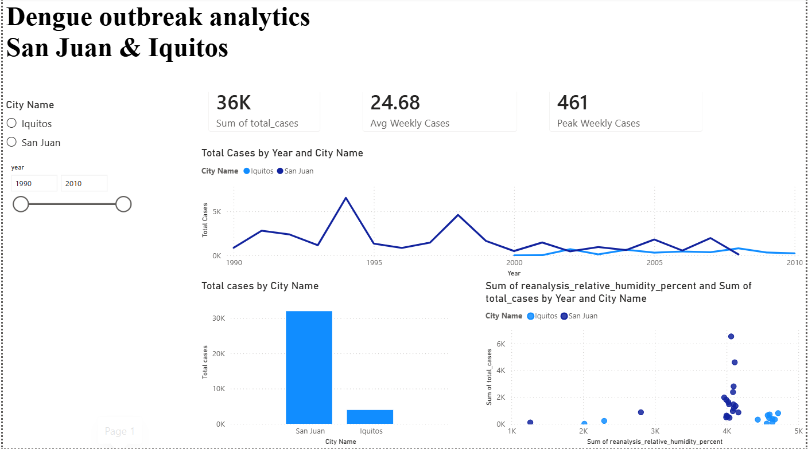
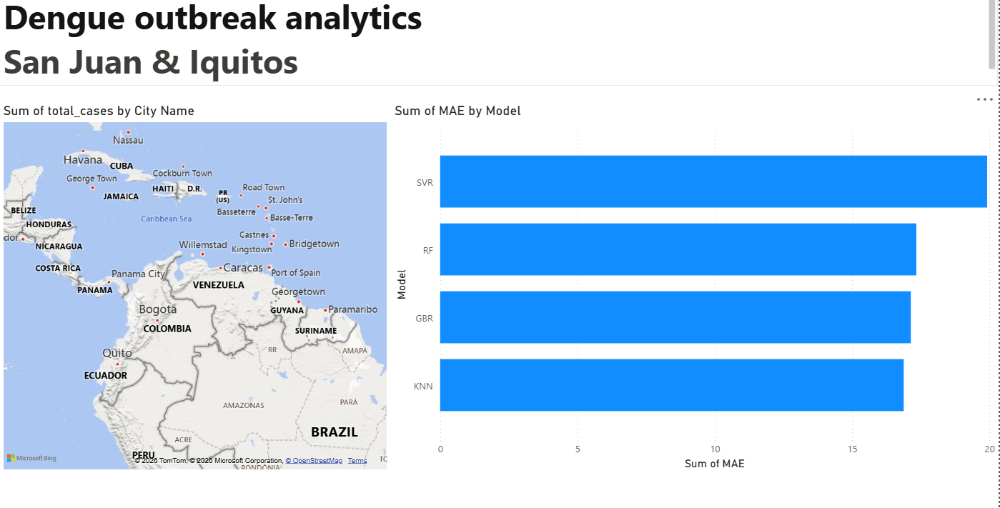
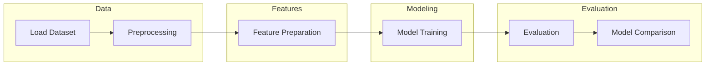
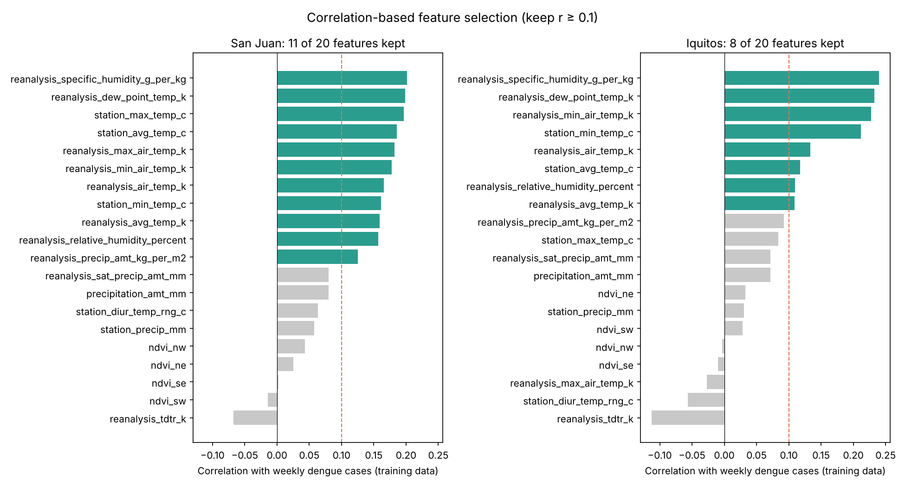

# Dengue Incidence Forecasting using Machine Learning

## Overview
This project predicts dengue cases using machine learning models trained on meteorological data. It explores how environmental factors influence outbreaks and builds a forecasting pipeline for two cities.

---
## Dashboard

### Page 1 — Outbreak & Climate Analysis

### Page 2 — Forecasting Model Comparison

## Workflow

---

## Dataset

View dataset details

### Source
DrivenData DengAI Dataset  

### Features

| Category        | Variables                          |
|----------------|-----------------------------------|
| Climate        | Temperature, Humidity             |
| Weather        | Precipitation                     |
| Environment    | Vegetation Index                  |
| Location       | City-level data                   |

### Cities

| City       | Country        |
|------------|----------------|
| San Juan   | Puerto Rico    |
| Iquitos    | Peru           |

---

## Methodology

View detailed steps

### Data Preprocessing
- Missing values handled using mean imputation  
- Temperature unit conversion  
- Rounding for consistency  

### Feature Preparation
- Dropped identifier and date columns (city, week of year, week start date)  
- One-hot encoded the year, dropping one year column to avoid the dummy variable trap  
- Standardized the features before modeling  
- Random 70/30 train/test split for each city  

### Feature Selection
- Correlation of each of the 20 climate and vegetation variables with weekly cases, measured on the training data only  
- Kept features with a correlation of at least 0.10 and dropped negative and weak ones (see [`scripts/feature_selection.py`](scripts/feature_selection.py))  

### Models Used
- K-Nearest Neighbors (KNN)  
- Random Forest (RF)  
- Gradient Boosting Regressor (GBR)  
- Support Vector Regressor (SVR)  

### Evaluation Metric
- Mean Absolute Error (MAE)  

---

## Results

### Model Performance (MAE ↓)

| Model | San Juan | Iquitos | Average |
|------|----------|---------|---------|
| KNN  | **16.88** | 6.31   | **11.60** |
| RF   | 17.34    | 6.34    | 11.84 |
| GBR  | 17.15    | 6.66    | 11.91 |
| SVR  | 19.93    | **4.91** | 12.42 |

MAE on a held-out test split, from a single run of [`notebooks/thesis2_SJ.ipynb`](notebooks/thesis2_SJ.ipynb). Results change noticeably between runs because the split and the tree-based models are not seeded; the seeded run in the next section ranks the models differently.

### Feature Selection Results

Each city starts with 20 candidate features. Features are kept only if their correlation with weekly cases (training data only) is at least 0.10.

| City | Candidates | Selected (random split) | Selected (chronological split) |
|------|-----------|-------------------------|--------------------------------|
| San Juan | 20 | 11 | 11 |
| Iquitos  | 20 | 8  | 6  |

MAE on a seeded random 70/30 split (year dummies kept), all features vs selected features:

| Model | San Juan: all | San Juan: selected | Iquitos: all | Iquitos: selected |
|------|------|------|------|------|
| KNN | 21.61 | 21.77 | 5.58 | 5.48 |
| RF  | 21.17 | 21.05 | 5.96 | 5.41 |
| GBR | 20.14 | 20.47 | 6.06 | 6.16 |
| SVR | 24.07 | 23.60 | 5.20 | 5.07 |

Selection removed 45% (San Juan) and 60% (Iquitos) of the variables with changes in MAE of roughly ±0.5 or less, so it simplifies the model without hurting accuracy on this split. It does **not** consistently improve accuracy, and on a chronological split (train on the earlier 70% of weeks, test on the latest 30%) the effect was mixed, for example Gradient Boosting in San Juan went from 29.25 to 31.77. Chronological errors are also much higher than random-split errors (KNN in San Juan: 29.5 vs 21.6), so a random split makes the models look better than they would be at forecasting future weeks. Full numbers are in [`results/feature_selection_results.csv`](results/feature_selection_results.csv).

---

### Key Findings

- Model ranking is not stable: KNN had the lowest average MAE in the notebook run, but Gradient Boosting was best on the seeded split, so the four models perform similarly  
- SVR performed best for Iquitos, but worst for San Juan  
- Weather variables strongly influence dengue cases  

---

### Final Insight

Lower MAE indicates better prediction accuracy. In the notebook run KNN gave the lowest average error, but the margin over Random Forest and Gradient Boosting is small and the ranking changes with the random split, so no single model clearly wins.

---

## Technologies Used

---

## How to Run

The analysis is in [`notebooks/thesis2_SJ.ipynb`](notebooks/thesis2_SJ.ipynb) and was developed in Google Colab.

1. Open the notebook in Google Colab (File → Upload notebook).
2. Upload the CSV files from [`data/`](data/) to Colab's `/content/` folder, which is where the notebook reads them from.
3. Run all cells.

To reproduce the feature selection results from the files in this repository, run `pip install pandas scikit-learn matplotlib` and then `python scripts/feature_selection.py`.

**Note:** the notebook also reads per-city files that are not in this repository (`SJ_dengue_labels_train_521.csv`, `IQ_dengue_labels_train_521.csv`, `SJ_dengue_features_test_417-null-data.csv` and `test_iq.csv`). The repository contains the combined `dengue_labels_train_1457.csv` and `dengue_features_test_417.csv` instead, which have to be split by city to match.

---

## Future Work

- Apply deep learning models  
- Incorporate additional environmental and demographic data  
- Use time-series models such as ARIMA  
- Deploy as a real-time forecasting system  
