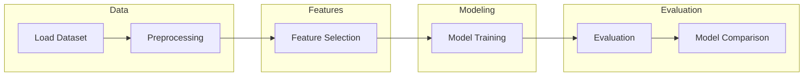

# Dengue Incidence Forecasting using Machine Learning

## Overview
This project predicts dengue cases using machine learning models trained on meteorological data. It explores how environmental factors influence outbreaks and builds a forecasting pipeline for two cities.

---
## Dashboard

### Page 1 — Outbreak & Climate Analysis

### Page 2 — Forecasting Model Comparison

## Workflow

---

## Dataset

View dataset details

### Source
DrivenData DengAI Dataset  

### Features

| Category        | Variables                          |
|----------------|-----------------------------------|
| Climate        | Temperature, Humidity             |
| Weather        | Precipitation                     |
| Environment    | Vegetation Index                  |
| Location       | City-level data                   |

### Cities

| City       | Country        |
|------------|----------------|
| San Juan   | Puerto Rico    |
| Iquitos    | Peru           |

---

## Methodology

View detailed steps

### Data Preprocessing
- Missing values handled using mean imputation  
- Temperature unit conversion  
- Rounding for consistency  

### Feature Selection
- Correlation analysis to identify important features  
- Removed negatively correlated and weak features  

### Models Used
- K-Nearest Neighbors (KNN)  
- Random Forest (RF)  
- Gradient Boosting Regressor (GBR)  
- Support Vector Regressor (SVR)  

### Evaluation Metric
- Mean Absolute Error (MAE)  

---

## Results

### Model Performance (MAE ↓)

| Model | San Juan | Iquitos | Average |
|------|----------|---------|---------|
| KNN  | **16.88** | 6.31   | **11.60** |
| RF   | 17.34    | 6.34    | 11.84 |
| GBR  | 17.15    | 6.66    | 11.91 |
| SVR  | 19.93    | **4.91** | 12.42 |

MAE on a held-out test split, from a single run of [`notebooks/main.ipynb`](notebooks/main.ipynb). Results can shift slightly between runs because the split and the tree-based models are not seeded.

---

### Impact of Feature Selection

- San Juan: 16 → 11 features  
- Iquitos: 16 → 8 features  
- Reduced noise and improved model performance  

---

### Key Findings

- KNN had the lowest average MAE across both cities, and the best score for San Juan  
- SVR performed best for Iquitos, but worst for San Juan  
- Feature selection significantly improved results  
- Weather variables strongly influence dengue cases  

---

### Final Insight

Lower MAE indicates better prediction accuracy. KNN gave the lowest average error in this study, although its margin over Random Forest and Gradient Boosting is small, so the choice of model matters less than the preprocessing and feature work.

---

## Technologies Used

---

## How to Run

The analysis is in [`notebooks/main.ipynb`](notebooks/main.ipynb) and was developed in Google Colab.

1. Open the notebook in Google Colab (File → Upload notebook).
2. Upload the CSV files from [`data/`](data/) to Colab's `/content/` folder, which is where the notebook reads them from.
3. Run all cells.

**Note:** the notebook also reads per-city files that are not in this repository (`SJ_dengue_labels_train_521.csv`, `IQ_dengue_labels_train_521.csv`, `SJ_dengue_features_test_417-null-data.csv` and `test_iq.csv`). The repository contains the combined `dengue_labels_train_1457.csv` and `dengue_features_test_417.csv` instead, which have to be split by city to match.

---

## Future Work

- Apply deep learning models  
- Incorporate additional environmental and demographic data  
- Use time-series models such as ARIMA  
- Deploy as a real-time forecasting system  
